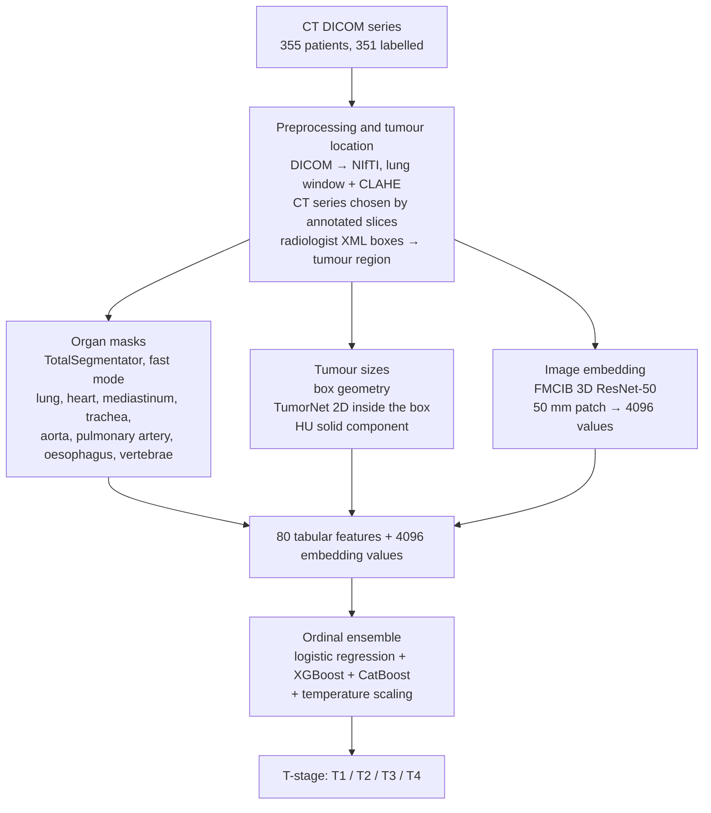

# Interpretable Lung Cancer T-Staging from CT Scans

**An interpretable, segmentation-based pipeline that predicts the T-stage (T1–T4) of lung cancer from CT, using measurements a radiologist can check.**


> Aadharsh Ramachandran, Sowmya Kamath S
> Department of Information Technology, National Institute of Technology Karnataka, Surathkal

---

## Overview

T-staging under the IASLC 8th edition depends on two things: **tumour size** (T1 ≤ 3 cm, T2 3–5 cm, T3 5–7 cm) and **local invasion** (a tumour that invades the heart, great vessels, trachea, oesophagus, vertebrae or mediastinum is T4 whatever its size). Most deep learning methods classify CT slices directly, so their predictions are hard to relate to these criteria.

This project measures the criteria instead:

1. The radiologist bounding boxes locate the tumour.
2. **TumorNet 2D** (ResNet-152 + FPN) segments the tumour inside the box, and **TotalSegmentator** segments the surrounding anatomy.
3. Tumour sizes, distances and contacts with each organ, and a pretrained **FMCIB** lesion embedding become patient-level features.
4. An **ordinal ensemble** (logistic regression, XGBoost, CatBoost) with temperature scaling predicts the stage.

Every input feature corresponds to a measurement such as a diameter, a distance or a contact, so each prediction can be traced back to evidence.

## Key results

Patient-level nested cross-validation (5 stratified folds × 3 repeats) on **351 labelled patients**. Every prediction comes from a model that never saw that patient.

| Method | Accuracy | Macro F1 | QWK | Within ±1 stage | AUC (T3–T4 vs T1–T2) |
|---|---|---|---|---|---|
| Always T1 | 47.6% | 16.1% | 0.00 | 77.5% | – |
| ResNet-152 (slice CNN) | 37.3% | 36.7% | – | – | – |
| DenseNet-121 (slice CNN) | 40.4% | 39.8% | – | – | – |
| Swin-Tiny (slice transformer) | 39.3% | 39.0% | – | – | – |
| **Proposed (mean of 3 repeats)** | **62.3%** | **56.6%** | **0.69** | **94.8%** | **0.90** |
| Proposed (majority vote of repeats) | 63.5% | 56.5% | 0.70 | 94.9% | – |

The macro F1 is about **17 points above the best CNN baseline**, and 94.8% of predictions are within one stage of the recorded label.

<details>
<summary><b>Per-stage results</b> (majority vote, n = 351)</summary>

| Stage | n | Precision | Recall | F1 |
|---|---|---|---|---|
| T1 | 167 | 78.8% | 75.4% | 77.1% |
| T2 | 105 | 53.9% | 45.7% | 49.5% |
| T3 | 57 | 47.7% | 71.9% | 57.3% |
| T4 | 22 | 50.0% | 36.4% | 42.1% |
| **Macro** | | **57.6%** | **57.4%** | **56.5%** |

</details>

<details>
<summary><b>Ablation of the input blocks</b> (mean over 3 repeats)</summary>

| Inputs | Acc | Macro F1 | QWK | Vote acc |
|---|---|---|---|---|
| Box geometry only | 61.3 | 54.9 | 0.69 | 63.2 |
| + TumorNet sizes | 62.3 | 55.7 | 0.68 | 63.0 |
| + solid-component sizes | 62.1 | 55.0 | 0.68 | 63.0 |
| + anatomy (TotalSegmentator) | 62.2 | 56.2 | 0.69 | 64.4 |
| + FMCIB embedding (full) | 62.3 | 56.6 | 0.69 | 63.5 |
| Full minus box block | 59.7 | 53.7 | 0.66 | 60.7 |
| Full minus TumorNet block | 60.3 | 55.0 | 0.68 | 61.5 |
| Full minus solid-component block | 61.3 | 54.9 | 0.69 | 61.3 |
| Full minus anatomy block | 61.8 | 55.4 | 0.69 | 63.0 |

Tumour size carries most of the staging information. No single added block gives a gain larger than the spread between repeats.

</details>

<details>
<summary><b>TumorNet segmentation</b> (MSD Task06_Lung test set, 165 slices from 6 held-out volumes)</summary>

| DSC | IoU | Precision | Sensitivity | Specificity |
|---|---|---|---|---|
| 89.32% | 80.79% | 89.57% | 89.11% | 99.95% |

</details>

## Pipeline



### 1. Preprocessing
- DICOM → 3D NIfTI (nibabel), keeping the physical voxel spacing.
- Lung window [−1400, 0] HU, CLAHE (clip limit 1.0, 16×16 tiles), resize to 256×256.
- For each patient, the series that holds the CT-annotated slices is selected, so boxes drawn on PET or fused images are never applied to the CT.

### 2. Tumour segmentation: TumorNet 2D
- ResNet-152 encoder (ImageNet) + FPN decoder, dropout 0.2.
- Trained on 1,657 tumour slices from MSD Task06_Lung (63 volumes, 70/20/10 split by volume).
- Loss: `0.4 · Focal + 0.6 · Dice`, AdamW (3e-5 encoder, 3e-4 decoder), cosine annealing with warm restarts.
- Threshold 0.45, which favours recall so that tumour slices are not missed (missed slices lead to under-staging).
- Run only inside the slightly dilated radiologist box. It gives a size for 296 of 355 patients.

### 3. Anatomy segmentation: TotalSegmentator
- Fast mode, which runs on GPUs with less than 8 GB of memory.
- Keeps the 8 structures relevant to T-staging: lung, heart, mediastinum, trachea, aorta, pulmonary artery, oesophagus and vertebrae.

### 4. Features (80 tabular values per patient)
| Group | Features |
|---|---|
| **Size: box geometry** | longest in-slice diameter, largest 3D diameter, depth, log-volume, size-based stage group |
| **Size: TumorNet** | 2D Feret diameter (IASLC definition), area, volume, fill ratio |
| **Size: HU solid component** | voxels > −300 HU inside the box, 3 mm opening, largest connected part |
| **Anatomy** | 2D contour distance and 3D voxel distance to each of the 8 structures, contact fraction per structure, fraction of the tumour inside the lung |
| **Shape and intensity** | mean, SD, skewness, kurtosis, entropy, energy, compactness, solidity, aspect ratio, extent |
| **Embedding** | FMCIB (frozen 3D ResNet-50, self-supervised on 11,467 CT lesions), 4096 values from a 50 mm cube at the box centre |

### 5. Ordinal ensemble classifier
- Frank & Hall cumulative scheme: learns P(T>1), P(T>2) and P(T>3), then P(T=k) = P(T>k−1) − P(T>k).
- Candidate models: ordinal logistic regression on the size features only and on the tabular features + 16 embedding PCs, a shallow monotone XGBoost, and class-weighted CatBoost on the tabular features + 16 PCs.
- The top 3 models by inner-fold score (mean of QWK and macro F1) are combined by soft voting. In the reported run these were CatBoost, ordinal LR and XGBoost.
- Temperature scaling, then three cut-points on the expected stage fitted on out-of-fold predictions.
- Imputation, scaling and the PCA of the embedding are fitted inside each training fold only.

## Dataset

[Lung-PET-CT-Dx](https://www.cancerimagingarchive.net/collection/lung-pet-ct-dx/) (TCIA). Only the CT series and the radiologists' XML bounding boxes are used. No clinical or demographic variables are used as inputs.

| Property | Value |
|---|---|
| Total patients | 355 |
| Labelled patients | 351 (T1 167 · T2 105 · T3 57 · T4 22) |
| Patients with a matched CT box | 352 |
| Slice thickness | 0.7–10 mm |
| Pixel spacing | 0.6–1.0 mm/px |

The CT scans are **not** included in this repository. Download them from TCIA.

## Repository structure

```
.
├── run_paper.ps1               # runs every step (PowerShell); see README_PAPER.md
├── local_shard_features.py     # step 1: series choice, TotalSegmentator, features per shard
├── add_boxes_to_cache.py       # step 1: radiologist XML boxes → tumour masks
├── box_seg_sizes.py            # step 2: TumorNet inside the box
├── box_solid_sizes.py          # step 3: HU solid-component size
├── extract_fmcib_features.py   # step 4: FMCIB embedding
├── final_t_staging.py          # step 5: ordinal ensemble, nested CV, calibration
├── ablation_v5log2.py          # ablation of the input blocks
├── experiment_ct_models.py     # single-model / feature-configuration comparison
├── dl_slice_baselines.py       # ResNet-152 / DenseNet-121 / Swin-Tiny baselines
├── always_t1_slice_baseline.py # always-T1 baseline
├── predict_one_scan.py         # T-stage of a single scan (demo)
├── feature_extraction.py, anatomy_v2.py, models.py, data_pipeline.py, evaluation.py, ...
├── models/                     # trained weights (Git LFS)
│   ├── TumorNet_2D_fold0_best.pth
│   ├── TumorNet_2D_threshold.pth
│   └── t_stage_model.pkl
└── results/
    ├── main/                   # main result: CV metrics, held-out predictions, confusion matrix
    ├── ablation/               # one folder per ablation variant + summary CSV
    ├── model_comparison/       # single-model / feature-configuration comparison
    └── sample_prediction/      # output of the one-scan demo
```

## Getting started

```bash
git clone https://github.com/AadharshRamachandran/capstoneproject.git
cd capstoneproject
git lfs pull                    # fetch the model weights
pip install -r requirements.txt
```

FMCIB needs its own Python 3.10 environment (`pip install foundation-cancer-image-biomarker --pre`). Its weights download on first use.

### Reproduce the paper (Windows PowerShell)
Edit the paths at the top of `run_paper.ps1` (DICOM shards, TumorNet checkpoint, labels CSV, FMCIB Python), then:

```powershell
.\run_paper.ps1 -List                 # list every step and its output file
.\run_paper.ps1                       # main pipeline (steps 1-5)
.\run_paper.ps1 -Steps ablation       # ablation of the input blocks
.\run_paper.ps1 -Steps baselines      # always-T1 and CNN baselines
```

Each step skips itself when its output already exists (`-Redo` forces a rerun). See [README_PAPER.md](README_PAPER.md) for details and rough run times.

### Predict the T-stage of one scan
```powershell
python prepare_sample_scan.py --pid Lung_Dx-A0001 --shard_dirs <shard folders> --model models\t_stage_model.pkl
python predict_one_scan.py --ckpt_dir models --fmcib_python <fmcib venv python> --labels_csv <labels.csv>
```
The demo prints the predicted stage, the four stage probabilities, the 90% conformal prediction set, the tumour size and the anatomy evidence, and writes `sample_scan/result.json`.

> `t_stage_model.pkl` was trained on all labelled patients, so for a patient from the dataset its output is a training-set prediction. The held-out prediction for each patient is in `results/main/final_t_staging_predictions.csv`.

## Limitations
- **Class imbalance:** there are only 22 T4 patients, so the T4 scores vary a lot from fold to fold.
- **Partial automation:** the radiologist boxes are an input, so the pipeline is not fully automatic.
- **TumorNet coverage:** TumorNet gives a size for 296 of 355 patients. The rest rely on the box geometry, the solid component and the embedding.
- **Single collection:** all results come from one public dataset and need confirming on an independent cohort with more T3/T4 patients.
- **T-stage only:** N and M are not estimated (N0M0 is a placeholder in the output).

## Acknowledgements
[TotalSegmentator](https://github.com/wasserth/TotalSegmentator) · [FMCIB](https://github.com/AIM-Harvard/foundation-cancer-image-biomarker) · [Medical Segmentation Decathlon](http://medicaldecathlon.com/) · [Lung-PET-CT-Dx (TCIA)](https://www.cancerimagingarchive.net/collection/lung-pet-ct-dx/)

## Citation
```bibtex
@inproceedings{ramachandran2026tstaging,
  title  = {An Interpretable Segmentation-Based Pipeline for Lung Cancer T-Staging from CT Scans},
  author = {Ramachandran, Aadharsh and Kamath S, Sowmya},
  year   = {2026}
}
```
